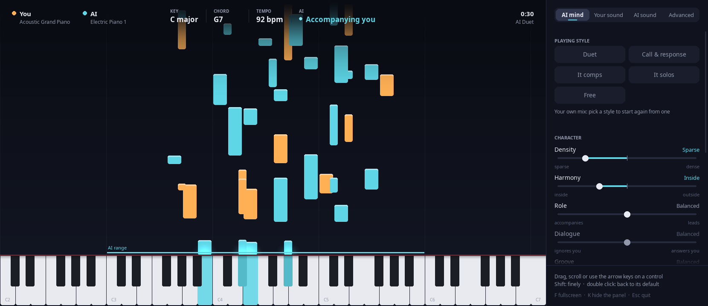

https://github.com/user-attachments/assets/d64728c6-4b59-4d35-81a4-7908be2604a1

# AI Music Generator

An interactive AI music generation system that responds to MIDI keyboard input in real-time. The system uses a transformer-based model to generate music based on your playing, creating a collaborative experience between human and AI.

## Features

- Real-time MIDI input processing
- AI-powered music generation based on your playing
- A real-time duo: the model improvises on electric piano while you play. It listens like a partner: it follows your key and your modulations, leans on the chord you play, keeps to your pulse, stays under you while you play and answers your phrases when you rest
- Different instruments for input and generated music
- MIDI file saving and playback capabilities

## Listen

The video at the top: a one-minute improvisation, played live on the Jetson duo: a human on piano (amber), the model on a warm electric piano (teal). The model heard it in C major.

- the video with sound, at the top of this page ([duo-c-major.mp4](samples/duo/duo-c-major.mp4) in the repo)
- [duo-c-major.ogg](samples/duo/duo-c-major.ogg): the audio alone (open *View raw* to play it in the browser)
- [duo-c-major.mid](samples/duo/duo-c-major.mid): the MIDI (track 1 is the human, track 2 the model)

The audio is the saved MIDI rendered with the same FluidSynth settings as `run_duet.sh`, and the video is the piano roll drawn over it. `sound.py bake` first puts in the sound the duo was played with (instruments, envelopes, reverb sends and the delay's echoes), which `main.py` saves next to it:
```bash
python sound.py bake generated/<time>.mid duo-baked.mid
eval "$(grep -E '^(REVERB|CHORUS)=' run_duet.sh)"
fluidsynth -ni -g 0.7 $REVERB $CHORUS -T oga -F duo.ogg /usr/share/sounds/sf2/FluidR3_GM.sf2 duo-baked.mid
python pianoroll.py video generated/<time>.mid --audio duo.ogg -o duo.mp4
```

## Piano roll

`pianoroll.py` shows the duo as you play: your notes and the model's rise from the keyboard, each in its own colour, and the keys light up while they sound. `run_duet.sh` opens it next to the duo (F: fullscreen, K: show or hide the knobs, Esc: close). It listens to what `main.py` sends to FluidSynth on Midi Through; to open it by hand, run `python pianoroll.py`.



At the top it says what the model hears and does: your key, the chord you play, your tempo once it has found your pulse, and whether it is accompanying you, answering your phrase or playing on its own. Beside it are knobs (`knobs.py`) to turn while you play, in four tabs. Drag a knob up or down (hold Shift to turn it finely) or use the wheel over it; a double click puts it back, and hovering says what it does. A knob is dimmed while what it shapes is not happening: `dialogue` while you play, `role` while you rest, `groove` until it has found your pulse.

- **AI mind**: musical controls, each with its two ends; each turns some of the model's knobs on the Jetson along a line whose middle is the duo's default:

  | Control | From ... to | Turns |
  |---|---|---|
  | density | sparse ... dense | `min_step`, `space` |
  | harmony | inside ... outside | `out_of_key`, `chord_tone` |
  | role | accompanies ... leads (while you play) | `under` |
  | dialogue | ignores you ... answers you (when your phrase ends) | `answer`, `echo` |
  | groove | loose ... tight | `grid` |
  | risk | safe ... adventurous | `temperature`, `top_p` |
  | focus | on you ... on itself | `memory` |
  | key follow | steady ... quick | `stay` |

  and `lowest`, `highest`: the octaves it may play. The model's knobs are kept in `~/.config/ai-duet/mind.json` and given back to the server whenever it restarts; the server log shows each turn (`duo: min_step = 32`).
- **Your sound** and **AI sound** (`sound.py`, in FluidSynth on the laptop): the General MIDI instrument, volume, the envelope (attack, decay, sustain and release, as how many times longer than the instrument's own, through SoundFont NRPNs), the reverb send, and a delay: its time, how loud the first echo is (0 turns it off) and how much each echo keeps of the one before. FluidSynth has no delay, so the echoes are MIDI notes, played on channels 2 (yours) and 3 (the model's). The sound is kept in `~/.config/ai-duet/sound.json` across sessions.
- **Advanced**: every knob of the model on its own (see *Tuning by ear* below).

## Requirements

- Python 3.8+
- MIDI keyboard/controller
- MIDI output device (virtual or physical)
- TensorFlow (for the AI model)

## Dependencies

The project requires several Python packages listed in `requirements.txt`. See the Setup section for installation instructions.

## Setup

1. Create and activate a virtual environment (recommended):
   ```bash
   python3 -m venv .venv
   source .venv/bin/activate
   ```

2. Install the required dependencies:
   ```bash
   pip install -r requirements.txt
   ```

3. Connect your MIDI keyboard/controller to your computer
4. Make sure you have a MIDI output device configured
5. The AI uses the pretrained [Anticipatory Music Transformer](https://github.com/jthickstun/anticipation) (trained on the Lakh MIDI dataset). It is downloaded from Hugging Face on first run: `music-medium-800k` on GPU/Apple Silicon, `music-small-800k` on CPU

## Usage

1. Start the model server (`python -m music_transformer.server`, or on a Jetson: see below)
2. Run the program (`AMT_SERVER` defaults to `localhost:8765`):
```bash
python main.py
```

3. Select your MIDI input device when prompted
4. Start playing on your MIDI keyboard: you play piano, the model plays electric piano at the same time
5. Press Ctrl+C to stop the program and save the duo to `generated/`

## Duo on a Jetson

The model runs on a Jetson Orin Nano (JetPack 6) and the laptop handles MIDI and sound; `run_duet.sh` connects the two.

**On the Jetson, once:**
- The repo in `~/Ai-Duet` with a venv `.venv` made with `--system-site-packages` (it uses NVIDIA's torch)
- The model converted to safetensors in `~/models/music-medium-800k` (transformers 5 refuses `.bin` files with torch < 2.6)
- Power mode MAXN_SUPER (it persists across reboots)
- `ssh jetson` works from the laptop with a key

**On the laptop, once:** FluidSynth with the `FluidR3_GM` soundfont, and the venv `.venv` of this repo with `pip install mido python-rtmidi pygame imageio-ffmpeg` (imageio-ffmpeg brings its own ffmpeg, for the videos).

**Every time the Jetson boots:**
```bash
ssh -t jetson sudo jetson_clocks   # the clocks go back to defaults after every reboot
./run_duet.sh                      # from this repo, on the laptop
```
`run_duet.sh` restarts everything: the server on the Jetson, the SSH tunnel on port 8765, FluidSynth, `main.py` on the KeyStep and the piano roll.

**Logs:** `~/amt_server.log` on the Jetson (`duo: started`, the key it hears you in each time it changes, then how many notes it heard and played);
`duet.log`, `fluidsynth.log` and `pianoroll.log` on the laptop in `$LOG_DIR` (default `/tmp`).

**Changing the code on the Jetson:** it does not pull from git; copy the files over, e.g.
`scp music_transformer/duo.py jetson:~/Ai-Duet/music_transformer/`, then run `./run_duet.sh` again.
The session tests need torch, so run them there: `python -m unittest tests.test_duo_session`.

**The model's sound** (top of `main.py`): `RING`, `RING_S` (how long its notes ring past what the model wrote), `SOFTER` (how much softer than you it plays), `GENERATED_CONTROLS` (volume, reverb and chorus sends, until the piano roll sets its own); the room itself is `REVERB` and `CHORUS` in `run_duet.sh`; the rest is in the **Your sound** and **AI sound** knobs.

**Tuning by ear:** turn the knobs in the **Advanced** tab of the piano roll while you play (they are `KNOBS` in `music_transformer/duo.py`, with their ranges); to change a default, edit it at the top of `music_transformer/duo.py`:
- `MIN_STEP`, `SPACE`: time between the model's onsets, when you rest and while you play
- `OUT_OF_KEY`, `CHORD_TONE`: how strongly it keeps to your key and leans on the chord you are playing
- `UNDER`: how firmly it stays below you while you play
- `ANSWER`, `ECHO`: how long after your phrase it answers it, and how closely it follows your intervals
- `GRID`: how tightly its onsets sit on your pulse
- `STAY` (top of `music_transformer/listener.py`): how soon it believes you modulated (lower = sooner, more flicker)
- `NO_REPEAT`: the length of runs it may not repeat
- `MEMORY`: how much of its own playing it remembers (shorter = listens to you more)
- `temperature` and `top_p` in `DuoSession`: how adventurous its choices are
- `lowest`, `highest` (knobs only, in `KNOBS`): the octaves it may play, from C of the lowest to B of the highest (C4 is middle C); the piano roll draws them as a line over the keys

## Instrument Selection

When changing instruments, enter a number between 0-127. Some interesting combinations to try:

- Keyboard: Piano (0), Generated: Strings (48)
- Keyboard: Electric Piano (4), Generated: Synth Pad (88)
- Keyboard: Acoustic Guitar (24), Generated: Choir (52)
- Keyboard: Trumpet (56), Generated: Synth Brass (62)

The program supports all General MIDI instruments (0-127), including:
- Pianos and Keyboards (0-7)
- Chromatic Percussion (8-15)
- Organs (16-23)
- Guitars (24-31)
- Basses (32-39)
- Strings (40-47)
- Ensembles (48-55)
- Brass (56-63)
- Reeds (64-71)
- Pipes (72-79)
- Synth Leads (80-87)
- Synth Pads (88-95)
- Synth Effects (96-103)
- Ethnic (104-111)
- Percussive (112-119)
- Sound Effects (120-127)

## Project Structure

```
ai-music/
├── CK_rec/              # MIDI recording and playback module
├── music_transformer/   # Music generation model
├── trained_models/      # Place for your trained models
├── generated/           # Directory for saved generated music
├── main.py             # Main application
├── pianoroll.py        # Piano roll of the duo, live or as a video
├── knobs.py            # The knobs beside the live piano roll
├── sound.py            # Your sound and the model's: instruments, envelope, reverb, delay
└── requirements.txt    # Project dependencies
```

## MIDI Configuration

The program supports:
- Multiple MIDI input devices
- MIDI output for playback
- Real-time MIDI message processing
- MIDI file saving and loading
- Different instruments on separate MIDI channels
- Program change messages for instrument selection

## Troubleshooting

If you encounter issues:
1. Check your MIDI device connections
2. Verify the model file exists in the correct location
3. Ensure all dependencies are installed
4. Check the console output for error messages
5. Make sure your MIDI output device is properly configured

## License

This project is licensed under the terms included in the LICENSE file.

## Contributing

Feel free to submit issues and enhancement requests!
